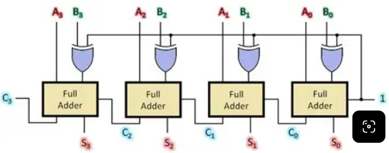
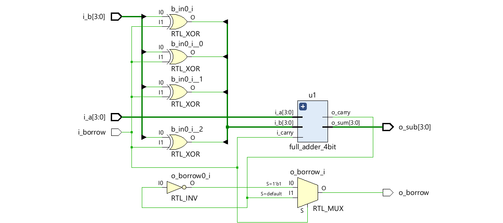

# Full Subtractor 4bit là mạch số dùng để trừ hai số nhị phân 4 bit a và b. Đầu ra của mạch này là kết quả trừ sub 4bit và bit mượn borrow
    Mạch này dùng phương pháp lấy số A + bù hai của B. Tức là sử dụng mạch full adder 4bit, đảo các giá trị bit của B trước khi đưa vào các khối full adder và cộng thêm 1 vào bit nhớ đầu vào của khối full adder đầu tiên.

    Mạch này cũng có khả năng cộng hai số nhị phân 4bit nhờ thay đổi bit đầu vào của block i_borrow = 0, khi đó các bit của B sẽ không đảo và thực hiện chức năng cộng bình thường.
#  `Schematic`

  

  

 
