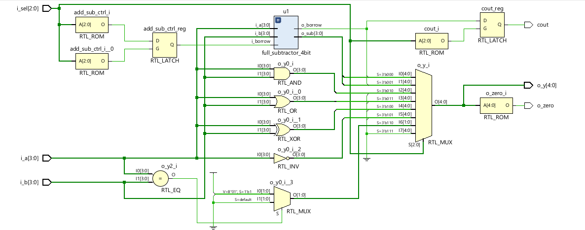
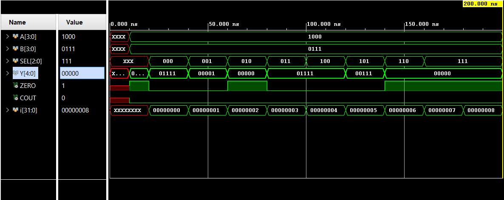

# 🔧 4-Bit Arithmetic Logic Unit (ALU)

## 📖 Overview

Đây là dự án thiết kế một bộ xử lý số học và logic (Arithmetic Logic Unit - ALU) 4-bit bằng Verilog HDL.

ALU thực hiện các phép toán số học và logic cơ bản trên hai toán hạng 4-bit và xuất kết quả 5-bit kèm theo các cờ trạng thái cần thiết.

Dự án được phát triển bằng Vivado 2025.2 và thử nghiệm trên nền tảng FPGA EBAZ4205 (Zynq-7010).

---

## 🎯 Design Requirements

### Inputs

|  Signal  |  Width  | Description |
|----------|---------|-------------|
|   i_a    |  4-bit  |  Operand A  |
|   i_b    |  4-bit  |  Operand B  |
|   i_sel  |  3-bit  |  Function selection |

### Outputs

|  Signal  |  Width  | Description |
|----------|---------|-------------|
|   o_y    |  5-bit  |  ALU result |
|   o_zero |  1-bit  |  Zero flag  |
|   cout   |  1-bit  |  Carry/Borrow output |

---

## ⚙️ Supported Operations

| SEL | Operation | Description |
|-----|-----------|-------------|
| 000 |   A + B   | Addition    |
| 001 |   A - B   | Subtraction |
| 010 |  A AND B  | Bitwise AND |
| 011 |  A OR B   | Bitwise OR  |
| 100 |  A XOR B  | Bitwise XOR |
| 101 |   NOT A   | Bitwise NOT |
| 110 |  A == B   | Equality comparison |
| 111 |   ZERO    | Constant 0  |

---

## 🏗️ Architecture

```text
             +------------------+
 i_a[3:0] -->|                  |
             |                  |
 i_b[3:0] -->|     ALU 4-bit    |--> o_y[4:0]
             |                  |--> o_zero
 i_sel[2:0]->|                  |--> cout
             +------------------+
```

### Internal Blocks

- Arithmetic Unit
  - Addition
  - Subtraction
  - Carry / Borrow generation

- Logic Unit
  - AND
  - OR
  - XOR
  - NOT

- Comparison Unit
  - Equality detector

- Status Flags
  - Carry Out
  - Zero Flag

---

## 🛠 Development Environment

|    Item    | Version          |
|------------|------------------|
|  Language  | Verilog HDL      |
|    Tool    | Vivado 2025.2    |
|   Device   | Zynq-7010        |
|   Board    | EBAZ4205         |
| Simulation | Vivado Simulator |

---

## 📷 Results

### RTL Schematic

<p align="center">
  
</p>

### Simulation Waveform

<p align="center">
  
</p>


---

## 👨‍💻 Author

Nguyễn Ngọc Dũng

Digital Logic Design Project

2026